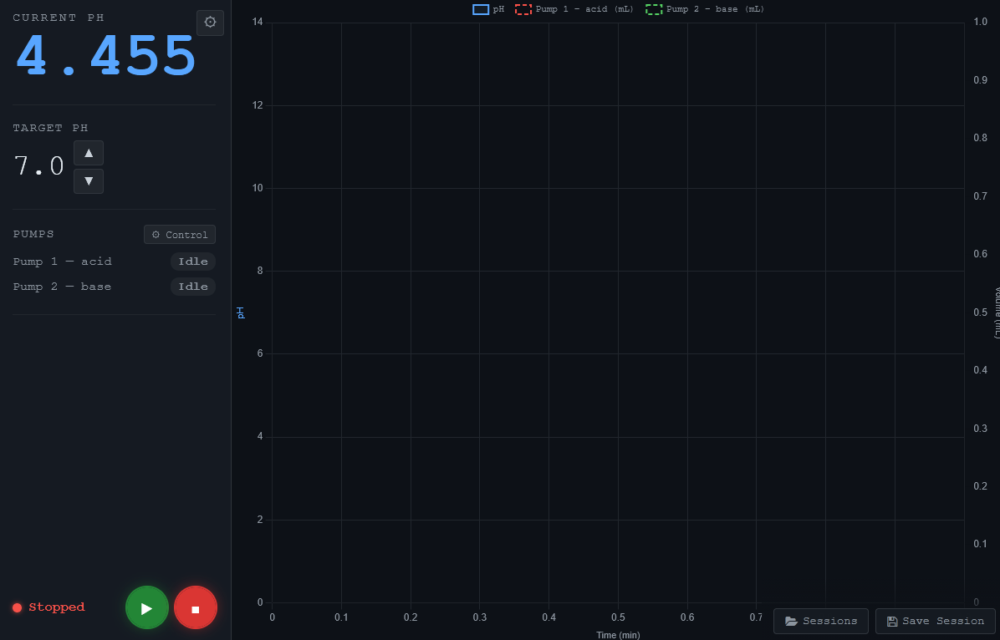
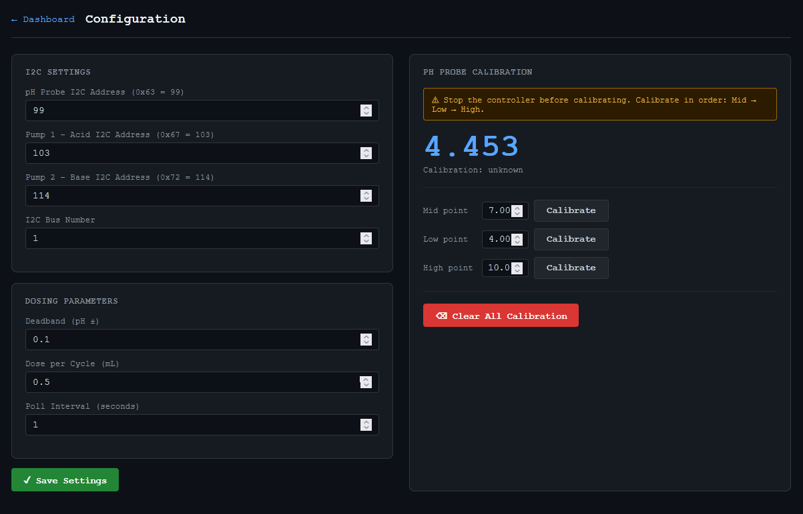

# pH Dosing Controller

Automated pH dosing for a tank or reservoir, built on a Raspberry Pi with Atlas Scientific EZO-pH
and EZO-PMP hardware. A proportional controller reads pH on a fast loop and doses acid or base to
hold a target, with a touchscreen dashboard, manual pump control, calibration wizards, CSV session
logging, and one-click email data export.

**Status:** running in daily lab use. The electronics and software are complete and working; the
enclosure and video guide are not done yet, and there is no cumulative dose cap — read
[Safety](#safety) before running it unattended.

---

## Screenshots

**Dashboard** — live pH readout, real-time chart, pump status, and session controls.



**Configuration** — I2C address settings, dosing parameters, and pH probe calibration.



---

## Safety

This system dispenses concentrated acid and base automatically, without supervision.

- **Handle pH-up / pH-down concentrates per their safety data sheets.** Eye protection and gloves
  when priming or calibrating; the pumps will dispense whenever the controller decides to.
- **There is no cumulative dose limit.** `dose_ml` caps a *single* dose, not a session. If the
  probe drifts, fails while reading a plausible value, or the target is set wrongly, the controller
  will keep dosing indefinitely. The running totals on the dashboard are display-only — nothing
  stops at a threshold.
- **Size the reservoirs so a worst-case runaway is survivable**, and supervise the first runs on a
  new setup or after recalibration.
- Set `dose_interval_sec` to give the solution time to mix. Dosing faster than the tank can
  homogenise makes the controller chase a pH it has already corrected, and overshoot.
- Keep the probe calibrated. A 3-point calibration and a healthy slope reading are what stand
  between "hold pH 7" and "add acid forever".

> The standalone CLI controller has a `--max-dose` session cap. The web app does not. Adding one is
> the most worthwhile open improvement to this project.

---

## Bill of Materials

| Qty | Component | Description | Link |
|---|---|---|---|
| 1 | Raspberry Pi 4 Model B | Main controller | [Amazon](https://www.amazon.com/Raspberry-Model-2019-Quad-Bluetooth/dp/B07TD42S27/) |
| 1 | Atlas Scientific EZO-pH Circuit | Embedded pH circuit | [Atlas Scientific](https://atlas-scientific.com/embedded-solutions/ezo-ph-circuit/) |
| 2 | Atlas Scientific EZO-PMP Kit | Peristaltic pump + EZO-PMP circuit (one acid, one base) | [Atlas Scientific](https://atlas-scientific.com/kits/ezo-pmp-kit/) |
| 1 | Atlas Scientific i3 Interlink | Electrical isolation between Pi and EZO circuits | [Atlas Scientific](https://atlas-scientific.com/electrical-isolation/i3-interlink/) |
| 1 | Hosyond Touchscreen | Capacitive touchscreen display for the Pi | [Amazon](https://www.amazon.com/Hosyond-Touchscreen-Compatible-Capacitive-Driver-Free/dp/B0D3QB7X4Z) |

> **The EZO-PMP needs two power supplies** — 3.3–5.5 V for the control PCB (from the Pi) and
> 12–24 V for the motor. A pump with logic power but no motor power looks *I2C-silent*, not merely
> "not pumping", which is a confusing failure to diagnose.

> **Don't skip the i3 Interlink.** The EZO-pH circuit is sensitive enough to read microvolts bleeding
> into the water from pump motors and other probes. Without isolation you get readings that drift or
> fluctuate for no visible reason.

### Default I2C addresses

| Component | Model | Address |
|---|---|---|
| pH probe circuit | Atlas Scientific EZO-pH | `0x63` (99) |
| Acid pump (Pump 1) | Atlas Scientific EZO-PMP | `0x67` (103) |
| Base pump (Pump 2) | Atlas Scientific EZO-PMP | `0x72` (114) |

Both pumps ship at `0x67`, so one must be readdressed before they can share a bus. All three
addresses are configurable from the dashboard at `/config`.

---

## Setup & Deployment

These steps match the working deployment: **Raspberry Pi 4 Model B, Raspbian 10 (buster),
Python 3.7.3, Flask 1.0.2**. It is an intentionally old, boring stack — the code targets Flask 1.x.

### 1. Enable I2C

```bash
sudo raspi-config     # Interface Options -> I2C -> Yes
sudo reboot
```

This adds `dtparam=i2c_arm=on` to `/boot/config.txt`. The working setup also pins the bus speed:

```
dtparam=i2c_arm=on
dtparam=i2c_arm_baudrate=100000
```

Verify afterwards — you want `/dev/i2c-1` to exist and your user to be in the `i2c` group:

```bash
ls /dev/i2c-*          # -> /dev/i2c-1
groups | grep i2c      # add with: sudo usermod -aG i2c $USER
lsmod | grep i2c       # -> i2c_bcm2835, i2c_dev
```

### 2. Install dependencies

```bash
sudo apt update
sudo apt install -y python3-flask i2c-tools
```

Flask comes from apt (1.0.2 on buster), not pip. `i2c-tools` gives you `i2cdetect`, which is the
fastest way to confirm the EZO boards are alive:

```bash
i2cdetect -y 1         # expect 63, 67 and 72
```

### 3. Get the code

```bash
git clone https://github.com/AutoBenton/PH-Controller.git ~/PH-Controller
cd ~/PH-Controller/ph_controller
python3 app.py
```

The dashboard is then on `http://<pi-ip>:8080`. Stop it with `Ctrl-C`.

#### Automated Service & Kiosk Setup (Recommended)

You can automatically configure the systemd background service, Chromium fullscreen kiosk, autologin, and I2C bus permissions using the included deployment script:

```bash
cd ~/PH-Controller
bash deploy/install.sh && sudo reboot
```

After rebooting, the controller runs automatically as a systemd service (`ph-controller.service`). You can manage it with:

```bash
sudo systemctl status ph-controller
sudo systemctl restart ph-controller
sudo systemctl stop ph-controller
```

### 4. Calibrate before first use

Open `/config` and run a 3-point calibration — **mid (7.0) first**, then low (4.0), then high
(10.0), rinsing the probe between buffers and waiting for readings to settle. Re-running mid later
clears the other two points.

Calibrate the pumps too (`/pumps`): dispense 10 mL, measure what actually came out, and enter the
measured figure. Uncalibrated pumps are ±5%; calibrated, ±1%.

### 5. Autostart on boot

Boot-time startup is wired through LXDE's session autostart. `/etc/xdg/lxsession/LXDE-pi/autostart`
ends with:

```
@/home/pi/start-atlasiot.sh
```

`start-atlasiot.sh` launches `app.py` (logging to `latest.log`) and then Chromium fullscreen at
`localhost:8080`. It hardcodes `/home/pi/...` paths, so adjust it if you clone elsewhere.

To set stronger dashboard credentials, export them in that script above the line that runs
`app.py`:

```bash
export PH_AUTH_USER="myname"
export PH_AUTH_PASS="a-stronger-password"
```

### Restarting after a change

The app runs with `debug=False`, which has two consequences that look like "my edit did nothing":

- **Templates are cached** — any change under `templates/` needs the app restarted, not just a
  browser refresh.
- **Static files are served with a 12 hour cache** — after changing anything in `static/`, bump the
  `?v=N` query string on its `<link>` / `<script>` tag, following the existing `theme.css?v=3`
  convention. A fullscreen kiosk browser cannot easily be made to hard-refresh.

---

## How dosing works

Each cycle the controller reads pH and compares it to the target:

- **Deadband** — no dosing at all while pH is within ± `deadband` of target. This is what stops it
  oscillating around the setpoint.
- **Proportional dose** — outside the deadband, dose volume scales with how far out you are:
  `dose ≈ dose_p_gain × (error − deadband)`, clamped to the pump's 0.5 mL minimum and to `dose_ml`.
  Set `dose_p_gain` to `0` to always dose the full `dose_ml` instead.
- **Pump 1 is acid** (lowers pH), **pump 2 is base** (raises pH). This convention is fixed
  throughout the code.

### Two independent rates

Measuring and dosing run on separate clocks, which is the key thing to understand when tuning:

| Setting | Controls |
|---|---|
| `poll_sec` — *Measurement Interval* | How often pH is read, charted and written to the CSV |
| `dose_interval_sec` — *Dose Interval* | The **minimum** time between doses |

Between doses the controller keeps measuring and logging at the fast rate — it simply declines to
dose. This lets you watch pH respond at 1-second resolution while dosing only as often as the tank
can actually mix, which is the single most effective way to stop overshoot.

Time spent inside the deadband does **not** consume the dose interval: if pH sits on target for an
hour and then drifts, the correction happens on the next measurement, not after another wait.

> Both default to 1 second, which makes dosing effectively continuous. Raise `dose_interval_sec` to
> match how long your tank takes to homogenise — typically tens of seconds to minutes.

---

## Email Data Export

Session CSV logs can be emailed directly from the UI without removing the SD card or using a USB drive.

### 1. Configure Email Credentials & Presets

1. Open **Configuration (⚙️)** from the dashboard.
2. In the **Email Credentials** section, enter:
   - **Sender Email** — your Gmail or SMTP address (e.g. `example@gmail.com`).
   - **Sender Password / App Password** — your password or app password (e.g. `examplePSWD`).
     > **Note for Gmail accounts:** Google requires a 16-character **App Password** (requires 2-Step Verification). Generate one under **Google Account → Security → 2-Step Verification → App Passwords** and paste it here.
   - *(Optional)* Expand **Advanced SMTP Options** to customize the SMTP host or port (defaults to `smtp.gmail.com:587`).
3. Click **Test Credentials** to verify SMTP connectivity and login authentication.
4. Add frequently used destination addresses in the **Preset Recipient Emails** list using **+ Add** and **Delete (×)**.
5. Click **Save All Settings**.

### 2. Exporting Data with Just a Few Clicks

- **After saving a session:** Once you save a session on the main screen, an export prompt banner appears and the **Export Data** button pulses. Click it to open the export popup with that session pre-selected.
- **Export Data button:** Click **Export Data** in the bottom action bar anytime to open the export dialog.
- **Saved Sessions browser:** Click **Sessions** in the bottom bar, then click the **Email** button next to any saved session row.
- **In the Export popup:**
  1. Select a recipient from your preset emails dropdown (or type a custom address).
  2. Select which saved session(s) to include using the checkboxes, or click **Select All**.
  3. Click **Send Email**. The controller attaches the CSV files, sends the email, and displays delivery confirmation.

---

## Kiosk Display & WiFi

On boot, `start-atlasiot.sh` launches Chromium with `--start-fullscreen` pointed at the dashboard,
which covers the Raspberry Pi desktop and its taskbar.

**To change the WiFi network (or reach the desktop for anything else):**

1. Plug a USB keyboard into the Pi.
2. Press **F11** to leave fullscreen. The LXDE taskbar reappears.
3. Click the network icon in the taskbar and pick your network as usual.
4. Press **F11** again to go back to fullscreen.

> This needs a real keyboard — F11 is a Chromium window shortcut, so it cannot be triggered from a
> button in the dashboard (`--start-fullscreen` is window-manager fullscreen, which the JavaScript
> Fullscreen API cannot exit).

**Why WiFi isn't configurable from the dashboard.** The dashboard is served *over the network you
would be reconfiguring* — if WiFi is down you cannot load the page to fix it, and if it is up you
could equally just SSH in. Doing it from the web app would also mean giving the app root access to
rewrite `wpa_supplicant.conf`, which is a poor trade on a device that drives dosing pumps. The Pi's
own network applet is the right tool.

---

## Remote Access

The dashboard runs on port `8080` and can be reached from anywhere behind two layers:

1. **Tailscale** — a private VPN mesh, so only *your* devices can reach the Pi. No router
   port-forwarding, no public exposure.
2. **HTTP Basic Auth** — a username/password prompt on every remote request. The on-Pi touchscreen
   (localhost) is exempt, so the kiosk keeps working without a prompt.

> **Do not port-forward port 8080.** The Pi runs an older OS and the app controls real dosing
> pumps — keep it on the private Tailscale network.

### Credentials

Defaults are `user` / `pass`. Override them with environment variables before launching the app
(see [Autostart](#5-autostart-on-boot) to make it persist):

```bash
export PH_AUTH_USER="myname"
export PH_AUTH_PASS="a-stronger-password"
python3 app.py
```

### Tailscale

Install on the Pi, then sign in with the same account on every device that needs access
(free tier is enough):

```bash
curl -fsSL https://tailscale.com/install.sh | sh
sudo tailscale up          # opens a login URL to approve the device
tailscale ip -4            # the Pi's permanent 100.x.x.x address
```

Install the Tailscale client on your PC ([tailscale.com/download](https://tailscale.com/download))
or phone, sign in with the same account, and browse to `http://100.x.x.x:8080`.

Two settings worth changing in the Tailscale admin console:

- **Disable key expiry** for the Pi (Machines → the Pi), so it never logs itself off and locks you
  out remotely.
- **Enable MagicDNS** to use `http://raspberrypi:8080` instead of the raw IP.

Optionally restrict the port to Tailscale only, removing LAN exposure entirely:

```bash
sudo ufw allow in on tailscale0 to any port 8080
sudo ufw allow in on lo to any port 8080
sudo ufw deny 8080
sudo ufw enable
```

---

## Project Structure

```
PH-Controller/
├── ph_dosing_terminal_controler.py   # Standalone CLI controller (no UI required)
├── deploy/                           # Provisioning & systemd service scripts
│   └── install.sh                    # Automated Raspberry Pi OS provisioning
├── CLAUDE.md                         # Architecture notes + hardware gotchas
├── docs/
│   ├── API.md                        # REST API reference
│   ├── LIBRARY.md                    # Using the drivers in your own scripts
│   └── *.png                         # Screenshots
└── ph_controller/
    ├── app.py                        # Flask entry point + Basic Auth
    ├── controller.py                 # Background dosing loop
    ├── sensors.py                    # pH sensor helper functions
    ├── mailer.py                     # SMTP email service & CSV attachment export
    ├── config.py / config.json       # Settings load/save + runtime values
    ├── STYLE.md                      # UI colour token reference
    ├── hardware/
    │   ├── ezo_i2c.py                # Low-level Atlas Scientific EZO I2C driver
    │   └── pump.py                   # High-level pump control helpers
    ├── routes/
    │   ├── dashboard.py              # Dashboard, session, & export API routes
    │   ├── pump_routes.py            # Manual pump control API routes
    │   └── config_routes.py          # Config, email test, & pH calibration API routes
    ├── templates/                    # Jinja2 HTML templates (standalone, no shared base)
    ├── static/                       # Theme CSS, on-screen numpad, on-screen keyboard
    └── sessions/                     # CSV session logs (auto-created, git-ignored)
```

---

## Further Documentation

| Document | Contents |
|---|---|
| [docs/API.md](docs/API.md) | REST API reference — every endpoint, request bodies, config fields, CSV format |
| [docs/LIBRARY.md](docs/LIBRARY.md) | Driving the EZO hardware from your own Python scripts |
| [CLAUDE.md](CLAUDE.md) | Architecture, I2C reliability notes, EZO datasheet gotchas |
| [ph_controller/STYLE.md](ph_controller/STYLE.md) | UI colour tokens and retheming |

---

## Roadmap

Not done yet, in rough priority order:

- **Cumulative session dose cap** for the web app — see [Safety](#safety). The CLI controller
  already has one; the web app does not.
- 3D-printed enclosure — STL and STEP files.
- Video build guide.
- Temperature compensation from a live probe (the EZO-pH supports it; nothing currently feeds it).

---

## License

MIT License — Copyright (c) 2026 Latif

See [LICENSE](LICENSE) for the full text.
